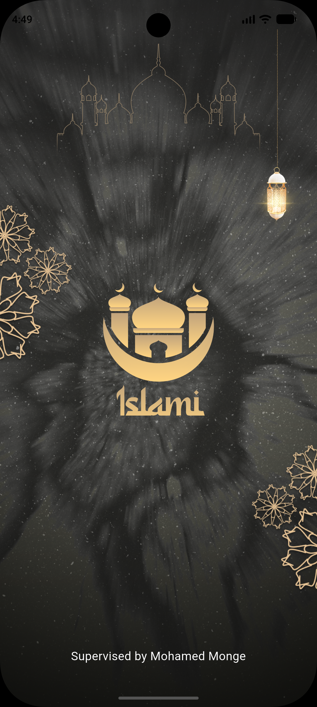
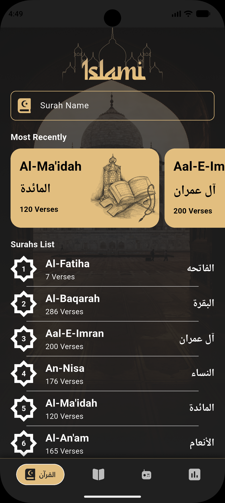
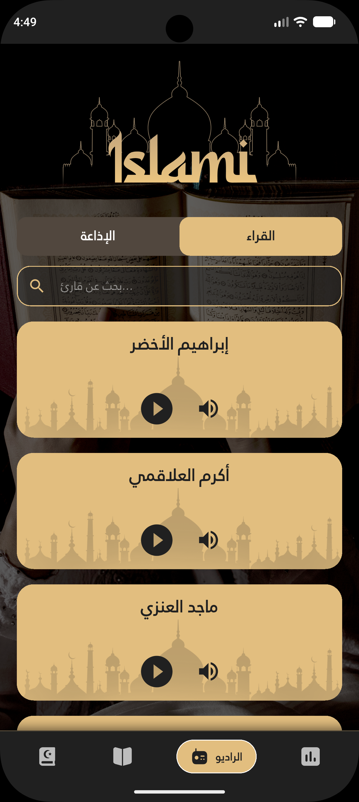
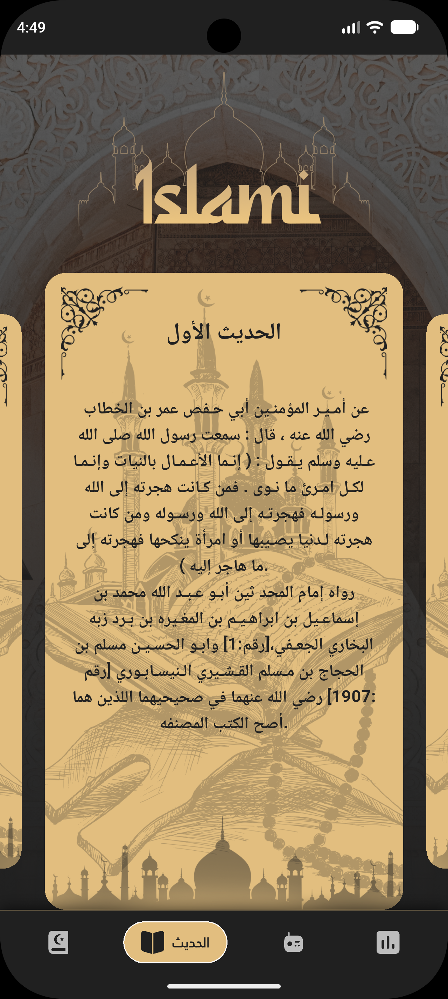
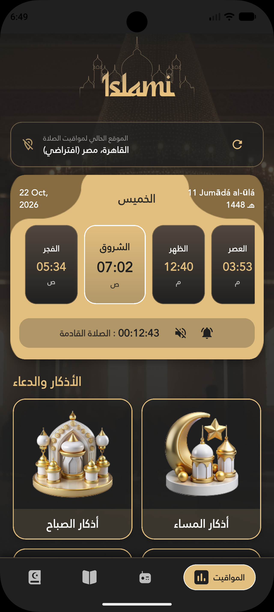
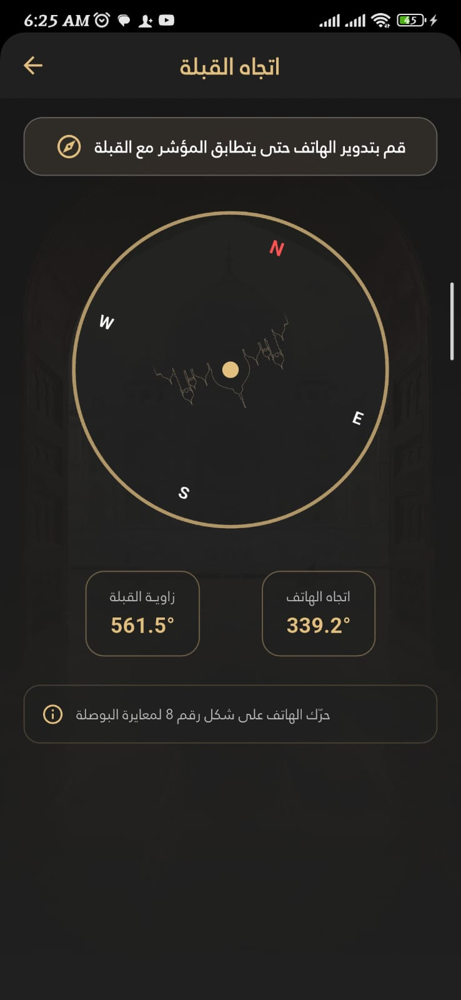
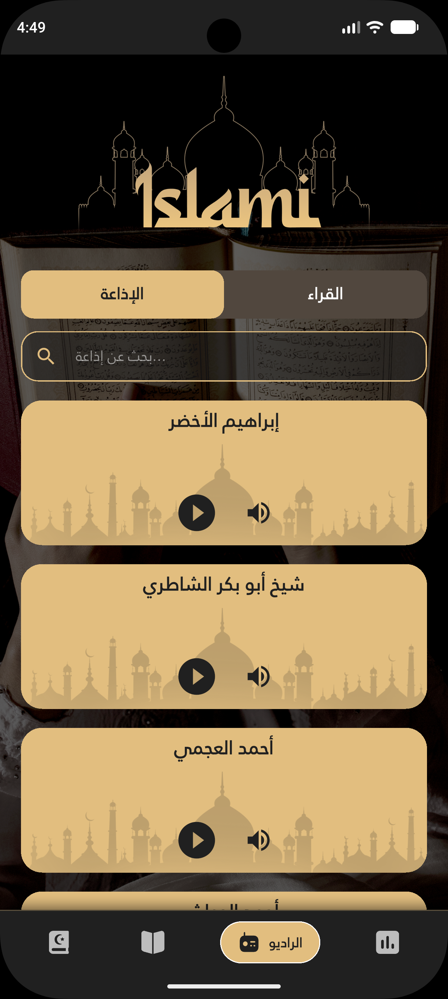

# 🕌 Islamii App

A Flutter application that brings essential Islamic resources and daily worship tools together in one place, with a clean interface designed to support Muslims in their daily routines.

## 📸 Screenshots

Explore the main screens of **Islamii App**.

### 🚀 Splash Screen

<p align="center">
  
</p>

### 📖 Quran & Reciters

<p align="center">
  
  
  
  
</p>

### 🤲 Azkar & Daily Supplications

<p align="center">
  
  
  
  
  
</p>

### 📚 Hadith

<p align="center">
  
</p>

### 🕌 Prayer Times & Adhan

<p align="center">
  
  
</p>

### 🧭 Qibla Direction

<p align="center">
  
  
</p>

### 📻 Quran Radio

<p align="center">
  
</p>
## ✨ Features

### 📖 Quran & Recitation
- Browse Quran-related content through the Mushaf section.
- Access Quran reading and reciters screens.
- Listen to Quran recitations through the available audio features.

### 📿 Azkar & Duas
- Morning Azkar.
- Evening Azkar.
- Azkar after obligatory prayers.
- Daily Azkar and supplications.
- Daily Duas.
- Tasbeeh and Istighfar.
- Repetition counts and remembrance notes in the Azkar data.

### 📚 Hadith
- Dedicated Hadith section for Islamic narrations.

### 🕌 Prayer Times & Location
- Fetch prayer times using the Al-Adhan API.
- Detect the user's location using GPS.
- Display the detected location or a default Cairo location when using the fallback.
- Refresh the location and prayer times together.
- Display a live countdown to the next prayer.
- Automatically scroll to the active prayer in the prayer list.
- Select a prayer-time calculation method.
- Save the selected calculation method using SharedPreferences.

### 🔊 Audio & Background Playback

- Quran recitation playback using the project's centralized audio player.
- Background audio playback using `audio_service` and `just_audio`, if verified in the current implementation.
- Android media notification with playback information and supported playback controls.
- Lock-screen playback controls, subject to Android system support and device settings.
- Automatic progression to the next available Surah, if implemented and verified.
- Quran radio streaming through the available radio feature.
- Adhan audio player integration in the prayer-times interface.

> **Note:** Automatic Adhan scheduling, playback after force-stopping the app, and playback restoration after device restart must be documented separately and only when the relevant implementation has been verified.

### 🧭 Qibla Direction
- Calculate the direction of the Qibla using the user's geographic coordinates and the coordinates of Makkah.
- Use compass sensor data when available.
- Provide a calculated geographic bearing as a fallback when compass hardware is unavailable.
- Handle location permission denial and missing compass sensors.
- Display a visual indicator when the device is facing within the configured tolerance of the Qibla direction.

### 🎨 User Experience
- Arabic-focused Islamic interface.
- Prayer countdown and active-prayer navigation.
- Location and prayer-time refresh controls.
- Persistent prayer calculation preferences.

## 🛠️ Built With

- **Flutter** — Cross-platform application development.
- **Dart** — Application programming language.
- **REST API** — Prayer times from the Al-Adhan API.
- **Provider / Flutter state management** — Used where implemented in the project.
- **SharedPreferences** — Local persistence for selected settings.
- **geolocator** — Device location access.
- **geocoding** — Converting coordinates into readable location information.
- **audioplayers** — Audio playback.
- **flutter_qiblah** — Compass and Qibla-related sensor functionality.

## 🚀 Getting Started

### Prerequisites

- Flutter SDK
- Dart SDK
- Android Studio or Visual Studio Code

### Installation

1. Clone the repository:

   ```bash
   git clone https://github.com/mohamedmonge58-create/islamii_app.git
   ```

2. Navigate to the project directory:

   ```bash
   cd islamii_app
   ```

3. Install dependencies:

   ```bash
   flutter pub get
   ```

4. Generate any required files if the project configuration requires it:

   ```bash
   flutter pub run build_runner build --delete-conflicting-outputs
   ```

5. Run the application:

   ```bash
   flutter run
   ```

## 📍 Permissions

The application uses Android location permissions to retrieve the device's geographic location for prayer-time calculations and Qibla direction.

Location features depend on device settings, granted permissions, and available hardware sensors.

## 👨‍💻 Author

**Mohamed Ibrahim Monge**

- GitHub: [@mohamedmonge58-create](https://github.com/mohamedmonge58-create)

---

Built with Flutter 💙
